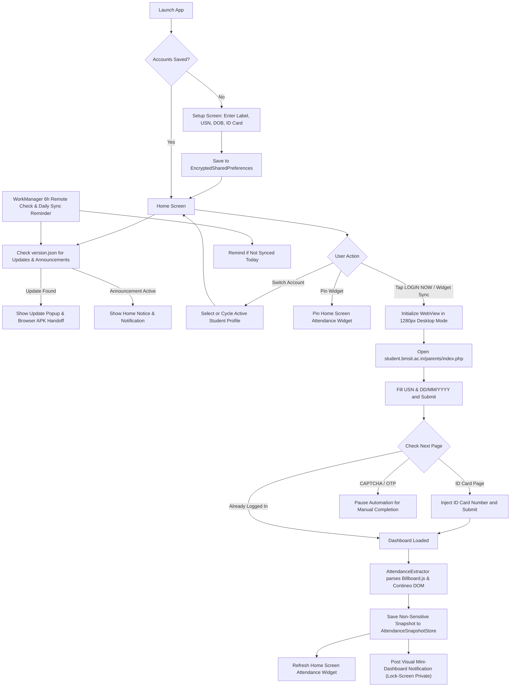

# 🚀 BMSIT CP

<div align="center">

[](https://github.com/adityasing9/BMSIT-CP/actions/workflows/build.yml)
[](https://bmsit-cp.vercel.app)
[](https://github.com/adityasing9/BMSIT-CP/releases/tag/latest)
[-3DDC84?logo=android&logoColor=white)](https://developer.android.com)
[](https://kotlinlang.org)
[](https://developer.android.com/jetpack/compose)
[](https://developer.android.com/reference/androidx/security/crypto/EncryptedSharedPreferences)
[](https://opensource.org/licenses/MIT)

**A high-performance Android utility that automates the two-step login process for the BMSIT&M ContinueO Portal, renders an authentic 1280px desktop experience on mobile, pins a live visual attendance widget on your home screen, delivers visual notification-bar alerts & serverless announcements, supports multiple student accounts, and enables in-app downloads.**

[🌐 **Website & Download Hub (bmsit-cp.vercel.app)**](https://bmsit-cp.vercel.app) • [📥 Direct Download](#-direct-download) • [✨ Key Features](#-key-features) • [📊 Widget & Alerts](#-2-visual-home-screen-attendance-widget) • [🔄 How It Works](#-how-it-works) • [🔒 Security](#-13-security--privacy-first) • [🏗️ Build from Source](#-building-from-source) • [❓ FAQ](#-frequently-asked-questions-faq)

</div>

---

## 📖 Overview

Every visit to the **BMSIT&M ContinueO Parent Portal** (`https://student.bmsit.ac.in/parents/index.php`) normally requires:
1. Entering your **USN**.
2. Selecting your **Date of Birth** through three separate dropdown menus (Day, Month, Year).
3. Submitting and waiting for server response.
4. Entering your **ID Card Number** on a separate verification screen.
5. Submitting again to finally reach your dashboard.

Furthermore, mobile browsers often render the portal in a cramped single-column layout where tables, Billboard.js charts, and navigation bars are clipped.

**BMSIT CP** streamlines the entire experience:
- **One-Tap 2-Step Login:** Completes USN, DOB dropdowns, and ID Card verification in seconds.
- **Visual Home Screen Attendance Widget:** Pin a live resizable widget showing your overall circular attendance ring, up to **8 subject progress bars** (`≥85%` green, `75–84%` amber, `<75%` red), 1-tap `Switch Account`, `Sync`, and `Portal ↗`.
- **Notification Bar Mini-Dashboard & Alerts:** Dismissible expanded visual notification sorting lowest-attendance subjects first, **Lock-Screen Privacy** (`VISIBILITY_PRIVATE`), **Daily Sync Reminders**, **6-Hour Background Update Alerts**, and **Serverless Remote Announcements** via `version.json` without needing app updates.
- **Multiple Accounts:** Store multiple student profiles and switch between them on the Home Screen, Widget, or Notification Bar with one tap.
- **Full In-App File Downloads:** Download `[NOTES]`, circulars, and syllabus PDFs directly through Android's native `DownloadManager` with session cookies preserved.
- **Built-In Feedback & Complaint System:** Report bugs or submit suggestions directly in-app or at [bmsit-cp.vercel.app/feedback](https://bmsit-cp.vercel.app/feedback) via Web3Forms, with anonymous submission support and zero credential sharing.
- **Open in External Browser:** One-tap option to launch the portal in Chrome, Brave, or Firefox from the Home Screen, Login bar, Widget, or Notification.
- **Over-The-Air (OTA) Update Alerts:** Multi-tier release checker via Fastly CDN & GitHub Releases with 1-tap browser APK handoff.
- **Full Desktop Layout:** Renders the portal in its authentic 1280px desktop layout by default with smooth pinch-to-zoom.
- **100% Local Credential Security:** All USN, DOB, and ID Card secrets stay encrypted on-device with hardware-backed **AES-256-GCM**.

---

## 📥 Direct Download

Grab the latest compiled APK directly from GitHub Releases or the web hub:

| Release Asset | Description | Direct Link |
| :--- | :--- | :--- |
| **`BMSIT-CP.apk`** | Latest compiled Android APK (`v1.2.20`) | [⬇️ **Download APK**](https://github.com/adityasing9/BMSIT-CP/releases/download/latest/BMSIT-CP.apk) |
| **GitHub Releases** | Release notes, changelog & assets | [📦 **View Releases**](https://github.com/adityasing9/BMSIT-CP/releases/tag/latest) |
| **Web Download Hub** | Overview, Android guide & feedback portal | [🌐 **bmsit-cp.vercel.app**](https://bmsit-cp.vercel.app) |

> **Note for Installation:** Since BMSIT CP is distributed outside Google Play Store, Android will prompt to *"Allow installation from this source"*. If Google Play Protect shows a generic unrecognized-signer prompt (*"Harmful app blocked"*), tap **"Install anyway"** to proceed (see [FAQ #12](#-frequently-asked-questions-faq)).

---

## ⚖️ Why BMSIT CP?

| Feature / Experience | Standard Web Browser | With BMSIT CP |
| :--- | :--- | :--- |
| **Login Time** | 45–60 seconds of repetitive typing | **~2–3 seconds (Single Tap)** |
| **Home Screen Glance** | None — must log in every time | **Live 8-subject visual attendance widget + circular ring** |
| **Notification Alerts** | None | **Visual mini-dashboard, shortage alerts & daily reminders** |
| **Remote Notices** | None | **Serverless `version.json` announcements without APK rebuilds** |
| **Multiple Accounts** | Log out, retype USN + DOB + ID Card | **Instant 1-tap account switching (App, Widget & Notification)** |
| **Credential Storage** | Manual typing or browser autofill | **Encrypted local hardware keystore (AES-256-GCM)** |
| **Layout Quality** | Squished mobile layout; clipped tables | **True 1280px Desktop view with pinch-to-zoom** |
| **In-App Downloads** | Often fails without portal cookies | **Native `DownloadManager` with `PHPSESSID` & referer headers** |
| **App Updates** | Manual GitHub checks | **OTA popups + background update notifications** |
| **Cloud Dependency** | N/A | **Zero credential cloud — 100% on-device secrets** |

---

## ✨ Key Features

### 👥 1. Multiple Account Support
- **Multi-Profile Management:** Save credentials for multiple students simultaneously with custom friendly labels (e.g., `"Aaditya Singh"`, `"Ward 2"`).
- **Instant Account Switcher:** Switch active profiles directly from the **Home Screen**, **Settings**, the **Home Screen Widget**, or the **Notification Bar**.
- **Safe Privacy Masking:** When an account has no custom display label, the widget and notifications automatically mask the USN (`1T***02`) and never display DOB or ID Card numbers.

### 📊 2. Visual Home Screen Attendance Widget
- **Overall Circular Progress Ring:** Draws an anti-aliased status ring (`≥85%` green, `75–84%` amber, `<75%` red) directly on your home screen showing your average attendance across synced subjects.
- **Up to 8 Subject Progress Bars:** Clean **4×2 grid** (`widget_attendance.xml`) displaying individual subject percentages and color-coded progress bars; adapts cleanly to 4 cells on compact `2×2` / short resizes via `OPTION_APPWIDGET_MIN_HEIGHT`.
- **Contineo-Native Sync-on-Login Extractor (`AttendanceExtractor.kt`):**
  - Parses BMSIT Contineo's **Billboard.js** runtime (`window.bb.instance`, including multi-ring attendance gauges like `BCS501`–`BAI505A`) and SVG `.bb-chart-arc` / `.bb-bars` DOM while cleanly skipping CIE/Marks charts.
  - Also supports `.sc-progress` / `.cn-att-stat` progress widgets, combined Attendance + CIE course tables, Highcharts, Chart.js, and same-origin `iframe` pages.
- **1-Tap Widget Controls:** Tap **Switch** to cycle accounts, **Sync** / **Login & Sync** to launch automated login & capture fresh numbers, or **Portal ↗** to open Contineo in your browser.
- **One-Tap Pinning:** Add directly from **Settings → Home Screen Widget → Pin** (`AppWidgetManager.requestPinAppWidget`).

### 🔔 3. Notification Bar Visual Alerts, Serverless Push & Reminders
- **Dismissible Visual Mini-Dashboard (`NotificationCompat.DecoratedCustomViewStyle`):**
  - **Collapsed:** Overall attendance ring, shortage/status summary, masked/display account name, and status pill (`ON TRACK`, `WATCH`, or `SHORTAGE`).
  - **Expanded:** Circular ring + up to 6 subjects sorted **lowest percentage first**, with quick **Sync Now**, **Switch**, and **Portal ↗** action buttons.
- **Lock-Screen Privacy (`VISIBILITY_PRIVATE`):** Automatically shows a generic redacted message (`"Attendance updated — unlock device to view"`) on the lock screen so names, USNs, subjects, and exact percentages remain private until unlocked.
- **Smart Threshold Controls:** Choose `85%` (BMSIT warning badge) or `75%` (mandatory minimum) in Settings, toggle **Alert Only Below Threshold**, and test immediately with **Settings → Preview**.
- **Serverless Remote Announcements (`version.json` + `WorkManager`):**
  - `RemoteSyncCheckWorker` runs every **6 hours** when connected (plus immediately on app open) to fetch `version.json` via Fastly CDN.
  - Publishers can deliver portal downtime notices, exam alerts, or feature announcements cleanly by editing the `"announcement"` block in `version.json` — **zero app rebuild or update needed** (deduplicated by announcement `id` and version-range targeted).
- **Background APK Update Alerts:** Automatically checks every 6 hours and posts a clean status-bar alert with a **Download APK** shortcut when a newer release drops.
- **Customizable Daily Sync Reminders:** `DailySyncReminderWorker` reminds you once daily (`9 AM`, `6 PM`, or `8 PM`) **only if your attendance hasn't been synced yet today**.

### 🔄 4. In-App Update Alerts & 1-Tap Browser Install
- **Multi-Tier Update Engine:** Checks Fastly CDN (`raw.githubusercontent.com`), HTTP 302 GitHub release redirects, and the GitHub REST API — immune to mobile ISP API rate limits.
- **1-Tap Browser APK Download:** Tapping **Update Now** hands off the direct APK download to your browser cleanly without requiring invasive `REQUEST_INSTALL_PACKAGES` permissions.
- **Permanent Release Keystore:** Signed with a permanent unified keystore so OTA updates install cleanly without signature conflicts.

### 💬 5. Built-In Feedback & Complaint System
- **Powered by Web3Forms:** Submit bug reports, UI feedback, portal change alerts, or feature suggestions directly inside BMSIT CP (**Home Screen**, **Settings → Send Feedback**, or **Portal Error Screen**) or online at [**bmsit-cp.vercel.app/feedback**](https://bmsit-cp.vercel.app/feedback).
- **Anonymous Option & Credential Safety:** Email/contact field is optional, device diagnostics (`app_version`, Android OS, device model) are opt-in via a switch, and student credentials are never included in any payload.

### 🌐 6. Open Portal in External Browser
- **Home Screen Access:** Dedicated **Portal ↗** button right below **LOGIN NOW 🚀**.
- **Login Top App Bar & Post-Login Card:** Jump straight into Chrome, Brave, or Firefox from the portal view at any time, or directly from the Home Screen Widget and Notification Bar.

### 📥 7. Direct In-App File Downloads ([NOTES], Syllabus & Circulars)
- **Native Android DownloadManager:** Saves PDF notes, syllabus files, and circulars directly to your device's `Downloads` folder.
- **Session Cookie Propagation:** Injects active `PHPSESSID` session cookies and `Referer` headers so authenticated downloads succeed reliably.
- **MIME & Extension Correction:** Resolves `.pdf` filenames accurately and bridges `blob:` and base64 `data:` downloads.

### 💾 8. Data Export & Import (Backup & Restore)
- **Portable JSON Backup:** Export saved accounts to structured JSON with one tap (`Copy to Clipboard` or native Share Sheet).
- **Safe Import & Merge:** Restore and deduplicate accounts cleanly when moving to a new phone, and automatically refresh Home Widgets upon import.

### ⚡ 9. Intelligent Two-Step Automation
- **Step 1 (USN & DOB):** Populates `#username`, selects Day/Month/Year dropdowns, triggers `putdate()`, sets the password field, and submits via native `POST`.
- **Step 2 (ID Card Verification):** Polls for the verification prompt, injects the ID card number using native input setters, and submits.
- **Manual Handoff:** If a CAPTCHA or OTP appears, automation pauses immediately and provides a **Continue Manually** control without closing your session.

### 🖥️ 10. Genuine Desktop Mode (Default: ON)
- **1280px Viewport & Desktop UIkit Grid:** Forces the 1280px desktop layout so both the CIE Bar chart, multi-ring Attendance Gauge, and full course registration table fit properly.
- **Instant Mode Toggle:** Switch anytime between `🖥 Desktop ON` and `📱 Mobile` in the Login top bar with persistent preference.

### 🔄 11. Instant One-Tap Page Refresh
- Dedicated **Refresh** action in the Login top bar reloads the portal while keeping session cookies intact and re-extracts fresh attendance for your Widget & Notification.

### 🚀 12. Speed & Performance Optimizations
- Hardware-accelerated WebView (`LAYER_TYPE_HARDWARE`), reactive Kotlin Coroutines + `StateFlow`, and 150ms polling detection pipelines.

### 🔒 13. Security & Privacy First
- **AES-256 Encrypted Local Vault:** USN, Date of Birth, and ID Card Number are encrypted via `EncryptedSharedPreferences` backed by Android Keystore `MasterKey` (`AES256_GCM` / `AES256_SIV`).
- **Separated Display Snapshots:** Home screen widgets and notifications read only non-sensitive cached display stats (`AttendanceSnapshotStore`) — credentials never sit unencrypted in widget prefs, Logcat, or lock-screen views.

### 🎨 14. Theme & Appearance Engine
- **Light, Dark & System Modes** + **AMOLED Pure Black** dark surface option + **Material You Dynamic Colors** (Android 12+) + **5 Accent Palettes** (Classic Blue, Emerald Green, Royal Purple, Crimson Red, Sunset Amber) + quick theme cycle button on the Home Screen.

---

## 🔄 How It Works



---

## 📱 System Requirements

| Specification | Requirement |
| :--- | :--- |
| **Operating System** | Android 8.0 Oreo (API level 26) or newer |
| **Target SDK** | Android 14 (API level 34) |
| **Architecture** | `arm64-v8a`, `armeabi-v7a`, `x86`, `x86_64` |
| **Connectivity** | Active Internet connection (Wi-Fi / Mobile Data) |
| **Permissions** | `INTERNET`, `ACCESS_NETWORK_STATE`, `POST_NOTIFICATIONS` (Android 13+, runtime), `WRITE_EXTERNAL_STORAGE` (max API 28) |

---

## 🛠️ Technology Stack

- **UI & Architecture:** [Jetpack Compose](https://developer.android.com/jetpack/compose) with [Material 3](https://m3.material.io/)
- **State & Background Scheduling:** Kotlin Coroutines, `StateFlow`, `ViewModel`, and Jetpack **WorkManager** (`androidx.work:work-runtime-ktx:2.9.0`)
- **Home Screen Widget & Notifications:** Android `AppWidgetProvider`, `RemoteViews`, `Canvas` circular gauges, and `NotificationCompat.DecoratedCustomViewStyle` with `VISIBILITY_PRIVATE`
- **Web Automation & Extraction:** Android `WebView`, custom `WebViewClient` / `WebChromeClient`, Contineo autofill & Billboard.js / UIkit attendance JavaScript extractors
- **File Downloads:** Android `DownloadManager` with session cookies, referer headers, and blob JS bridge
- **Storage & Cryptography:** AndroidX Security (`androidx.security:security-crypto:1.1.0-alpha06`) with Android Keystore `MasterKey`
- **Feedback & Docs:** **Web3Forms** API + static docs hub hosted on Vercel (`docs/`)
- **Build & CI:** Gradle Kotlin DSL (`build.gradle.kts`) + GitHub Actions (`.github/workflows/build.yml`)

---

## 📣 Pushing Remote Announcements (No App Update Needed)

Once users are on **`v1.2.20+`**, maintainers can broadcast announcements by editing the `"announcement"` block in [`version.json`](version.json) on `main` (keep `versionCode` / `versionName` unchanged to avoid triggering an APK update prompt):

```json
"announcement": {
  "id": "unique-notice-id-2026-11-28",
  "enabled": true,
  "title": "Exam Hall Ticket Live",
  "message": "Portal hall tickets are available. Tap below or Sync inside BMSIT CP.",
  "actionUrl": "https://bmsit-cp.vercel.app",
  "actionLabel": "Open Hub",
  "minVersionCode": 23,
  "maxVersionCode": 999999
}
```

Users receive the notice automatically via `RemoteSyncCheckWorker` (every 6 hours with connectivity) and immediately upon opening the app, deduplicated by `"id"`. Set `"enabled": false` to stop delivering to new opens.

---

## 🏗️ Building from Source

### Prerequisites
1. **Android Studio** Hedgehog (2023.1.1) or newer
2. **Java Development Kit (JDK):** Version 17
3. **Android SDK Platform:** 34

### Compilation Steps

```bash
# 1. Clone the repository
git clone https://github.com/adityasing9/BMSIT-CP.git
cd BMSIT-CP

# 2. Compile Debug APK using the Gradle Wrapper
./gradlew assembleDebug

# 3. Run JVM Unit Tests
./gradlew testDebugUnitTest

# 4. Install directly to an attached Android phone or emulator
./gradlew installDebug
```

The output artifact is generated at:
```
app/build/outputs/apk/debug/app-debug.apk
```

---

## 📂 Codebase Structure

```text
app/src/main/java/com/continueo/autologin/
├── ContineoApp.kt                             # App startup, notification channels & WorkManager scheduler
├── MainActivity.kt                            # Single-activity entry point, widget/notification deep-links & Compose router
│
├── models/
│   ├── AttendanceModels.kt                    # AttendanceStatus, SubjectAttendance & AttendanceSnapshot models
│   └── Credentials.kt                         # Credentials & multi-account AccountProfile models
│
├── security/
│   ├── AttendanceSnapshotStore.kt             # Non-sensitive per-account display cache for Widget & Notifications
│   └── CredentialManager.kt                   # Multi-account AES-256 EncryptedSharedPreferences storage & backup I/O
│
├── automation/
│   ├── AttendanceExtractor.kt                 # Multi-strategy JS extractor (Billboard.js gauges/bars, .sc-progress, tables)
│   ├── AutomationEngine.kt                    # Coroutine automation state machine
│   ├── ContineoAdapter.kt                     # Robust JS injectors for login & ID card verification
│   ├── ContineoSelectors.kt                   # Portal URL, DOM selectors & timing constants
│   └── WebViewManager.kt                      # Desktop viewport, page load callbacks, cookies & DownloadManager bridge
│
├── widget/
│   └── AttendanceWidgetProvider.kt            # Resizable Home Screen Attendance Widget provider & system pinner
│
├── notifications/
│   ├── AttendanceNotificationManager.kt       # Visual mini-dashboard, shortage alerts, lock-screen privacy & remote notices
│   ├── AttendanceNotificationReceiver.kt      # BroadcastReceiver handling inline Notification "Switch" account cycling
│   ├── BackgroundNotificationWorkers.kt       # RemoteSyncCheckWorker (6h), DailySyncReminderWorker & NotificationScheduler
│   └── NotificationPreferences.kt             # Threshold (85%/75%), reminder schedule, dedupe & opt-in settings
│
├── ui/
│   ├── components/
│   │   └── FeedbackDialog.kt                  # In-app Web3Forms bug/feedback submission modal
│   ├── navigation/
│   │   └── NavGraph.kt                        # Compose Navigation routes
│   ├── screens/
│   │   ├── SetupScreen.kt                     # Add / edit student account credentials
│   │   ├── HomeScreen.kt                      # Account switcher, announcement banner, OTA popup, Feedback & "LOGIN NOW"
│   │   ├── LoginScreen.kt                     # WebView dashboard, status timeline, sync toast & desktop toggle
│   │   └── SettingsScreen.kt                  # Accounts, backup/restore, Widget Pin, Notification alerts & Feedback
│   ├── theme/                                 # ThemeManager, AMOLED dark mode, Material You & accent palettes
│   └── viewmodels/
│       └── LoginViewModel.kt                  # Automation orchestration & post-login attendance extraction trigger
│
└── utils/
    ├── AttendanceUiHelper.kt                  # Shared Canvas ring bitmap renderer, USN masker, alert summary & reminder helpers
    ├── FeedbackManager.kt                     # Web3Forms HTTP client & payload sanitizer
    ├── NetworkUtils.kt                        # Real-time connectivity check
    ├── ShareUtils.kt                          # WhatsApp / feedback URL intents & share card helpers
    └── UpdateManager.kt                       # version.json parser (OTA updates + RemoteAnnouncement) & browser download handoff

app/src/test/java/com/continueo/autologin/
└── UpdateAndAccountTest.kt                    # JVM unit tests (versioning, masking, feedback, attendance, announcements, reminders)

docs/                                          # Static product showcase, Android guide, extension page & Web3Forms feedback page
version.json                                   # OTA release metadata & serverless remote announcement payload
```

---

## ❓ Frequently Asked Questions (FAQ)

<details>
<summary><b>1. How does multiple account login work?</b></summary>
You can save as many accounts as you need (e.g. for siblings or multiple wards), each with its own USN, Date of Birth, ID Card Number, and optional display label. Switch profiles on the Home Screen, directly on the Home Screen Widget (<b>Switch</b>), or right inside the expanded Notification card.
</details>

<details>
<summary><b>2. How does the Home Screen Attendance Widget work and stay updated?</b></summary>
Because BMSIT's Contineo portal uses login verification/reCAPTCHA, BMSIT CP uses a <b>Sync-on-Login Snapshot</b>: whenever you log in or refresh your portal dashboard in the app, <code>AttendanceExtractor</code> parses Contineo's Billboard.js attendance gauge/charts and saves non-sensitive subject percentages locally for your active account. Pin the widget from <b>Settings → Home Screen Widget → Pin</b> (or long-press your launcher → <b>Widgets → BMSIT CP</b>), and tap <b>Sync</b> / <b>Login & Sync</b> on the widget anytime to refresh.
</details>

<details>
<summary><b>3. How do Notification Bar Alerts & Lock-Screen Privacy work?</b></summary>
After syncing, BMSIT CP posts a dismissible visual mini-dashboard showing your overall ring and lowest-attendance subjects sorted first, plus <b>Sync Now</b>, <b>Switch</b>, and <b>Portal ↗</b> buttons. With <code>VISIBILITY_PRIVATE</code>, your lock screen hides your name, USN, subject codes, and percentages until you unlock your device. Customize the warning threshold (<code>85%</code> or <code>75%</code>), enable alert-only mode, change daily reminder times (<code>9 AM</code> / <code>6 PM</code> / <code>8 PM</code>), or tap <b>Preview</b> in <b>Settings → Notification Bar Alerts</b>.
</details>

<details>
<summary><b>4. How can announcements reach my phone without updating the app?</b></summary>
On <code>v1.2.20+</code>, BMSIT CP checks <code>version.json</code> via Fastly CDN on startup and every 6 hours via Jetpack <code>WorkManager</code>. Important portal notices or downtime alerts placed in the <code>announcement</code> object appear in your notification bar automatically without waiting for an APK install.
</details>

<details>
<summary><b>5. How does the in-app update check work?</b></summary>
On startup, via <b>Settings → Check for Updates</b>, or via 6-hour background update notifications, BMSIT CP checks for new releases. Tapping <b>Update Now</b> or <b>Download APK</b> opens the direct APK download in Chrome/your default browser for clean installation.
</details>

<details>
<summary><b>6. Are my college credentials safe?</b></summary>
Yes, 100%. Your USN, DOB, and ID Card Number never leave your physical device and are encrypted using <code>EncryptedSharedPreferences</code> + Android Keystore (AES-256-GCM). There is no backend server tracking your credentials, and optional Web3Forms feedback never includes credentials.
</details>

<details>
<summary><b>7. Can I download subject notes and circulars inside the app?</b></summary>
Yes! Tapping <b>[NOTES]</b> or any PDF/circular download link downloads the file directly to your phone's <b>Downloads</b> folder using Android's native <code>DownloadManager</code> with active <code>PHPSESSID</code> session cookies and referer headers preserved.
</details>

<details>
<summary><b>8. How do I open the portal in an external browser (Chrome / Brave)?</b></summary>
Tap <b>Portal ↗</b> on the Home Screen, Home Screen Widget, or expanded Notification Bar, or tap the <b>Open in Browser</b> icon inside the Login screen top bar or post-login card.
</details>

<details>
<summary><b>9. What happens if the portal displays a CAPTCHA or OTP?</b></summary>
The app adheres strictly to anti-bot controls: if a CAPTCHA challenge appears, automation pauses immediately and lets you complete it manually right inside the WebView.
</details>

<details>
<summary><b>10. How do I refresh the portal or toggle Desktop/Mobile mode?</b></summary>
Tap the <b>Refresh</b> icon in the Login top bar anytime to reload while staying logged in (which also refreshes your attendance widget & notification). Tap <b>🖥 Desktop ON / 📱 Mobile</b> at top-right to switch viewport modes cleanly.
</details>

<details>
<summary><b>11. How do I backup or transfer my accounts to another phone?</b></summary>
Go to <b>Settings → Data Management</b>: tap <b>Export Accounts Backup</b> to copy or share your JSON backup, then on your new device tap <b>Import Accounts Backup</b>, paste the text, and tap <b>Import</b>.
</details>

<details>
<summary><b>12. Why does Google Play Protect show "Harmful app blocked"?</b></summary>
Because BMSIT CP is an open-source, self-signed APK distributed outside the Google Play Store, Google Play Protect displays a generic prompt for unrecognized publishers. Tap <b>"Install anyway"</b> to continue.
</details>

<details>
<summary><b>13. Why does Android show "App not installed as package conflicts with an existing package"?</b></summary>
Android requires updates to share the exact same signing key. Starting from <b>v1.2.0</b>, a permanent release keystore is used across all releases. If upgrading from a pre-v1.2.0 build:
1. Open <b>Settings → Data Management → Export Accounts Backup</b> and save your JSON backup.
2. Uninstall the old pre-v1.2.0 app once.
3. Install the latest APK from GitHub Releases or <a href="https://bmsit-cp.vercel.app">bmsit-cp.vercel.app</a>.
4. Open <b>Settings → Import Accounts Backup</b> to restore your profiles.
</details>

---

## ⭐ Say Thank You & Show Support

If you find **BMSIT CP** helpful:
- **Give this repository a ⭐ star!** It helps more BMSIT students and parents discover the app.
- **[Follow @adityasing9 on GitHub](https://github.com/adityasing9)** for more utilities and open-source projects!
- **Share BMSIT CP** with your classmates and friends via WhatsApp!
- **Send Feedback or Report Issues** right inside the app (**Settings → Send Feedback**) or at [**bmsit-cp.vercel.app/feedback**](https://bmsit-cp.vercel.app/feedback)!

---

## 📄 License

This project is licensed under the [MIT License](LICENSE).

**Disclaimer:** This software is an independent, client-side productivity tool designed exclusively for authorized students and parents accessing their own BMSIT&M ContinueO portal accounts. It does not tamper with or bypass college security protocols. The developers assume no responsibility for any unauthorized usage.
