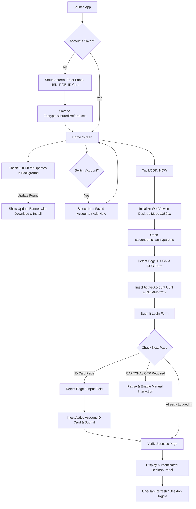

# 🚀 ContinueO Auto Login

<div align="center">

[](https://github.com/adityasing9/BMSIT-CP/actions/workflows/build.yml)
[](https://github.com/adityasing9/BMSIT-CP/releases/tag/latest)
[-3DDC84?logo=android&logoColor=white)](https://developer.android.com)
[](https://kotlinlang.org)
[](https://developer.android.com/jetpack/compose)
[](https://developer.android.com/reference/androidx/security/crypto/EncryptedSharedPreferences)

**A high-performance Android utility that automates the repetitive two-step login process for the BMSIT&M ContinueO Portal, delivers an authentic responsive desktop portal experience on mobile, supports multiple student accounts, and features automated in-app updates.**

[📥 Download Latest APK](#-direct-download) • [✨ Key Features](#-key-features) • [🔄 How It Works](#-how-it-works) • [🔒 Security & Privacy](#-security--privacy-first) • [🏗️ Build from Source](#-building-from-source)

</div>

---

## 📖 Overview

Every visit to the **BMSIT&M ContinueO Parent Portal** (`https://student.bmsit.ac.in/parents/index.php`) normally requires:
1. Entering your **USN**.
2. Selecting your **Date of Birth** through three separate dropdown menus (Day, Month, Year).
3. Submitting and waiting for server response.
4. Entering your **ID Card Number** on a separate verification screen.
5. Submitting again to finally reach your dashboard.

Furthermore, mobile browsers often render the portal in a cramped, single-column responsive layout where navigation headers and tables are cut off or misaligned.

**ContinueO Auto Login** eliminates this friction:
- **One tap** on **LOGIN NOW** completes the entire 2-step authentication flow in seconds.
- **Multiple Accounts:** Store multiple profiles (for siblings, friends, or parents managing multiple wards) and switch between them with one tap.
- **Auto Update:** Checks for new releases directly from GitHub, downloads APK updates in-app with live progress, and triggers installation seamlessly.
- **Full Desktop Layout:** Renders the portal in its authentic desktop view by default (1280px viewport), with full pinch-to-zoom and smooth panning.
- **One-Tap Refresh:** Dedicated reload button in the top bar to update attendance, marks, and notices without losing your login session.
- **100% Local Security:** All credentials stay encrypted on your device with hardware-backed **AES-256-GCM**.

---

## 📥 Direct Download

Ready to use? Grab the latest pre-compiled debug/release APK directly from GitHub Releases:

| Release Asset | Description | Direct Link |
| :--- | :--- | :--- |
| **`ContinueO-AutoLogin.apk`** | Latest compiled Android APK | [⬇️ **Download APK**](https://github.com/adityasing9/BMSIT-CP/releases/download/latest/ContinueO-AutoLogin.apk) |
| **GitHub Releases** | Release notes, changelog & assets | [📦 **View Releases**](https://github.com/adityasing9/BMSIT-CP/releases/tag/latest) |

> **Note for Installation:** Since this APK is distributed directly outside the Google Play Store, Android will ask you to *"Install apps from unknown sources"* or *"Allow installation from this source"*. Enable this toggle to proceed with installation.

---

## ⚖️ Why ContinueO Auto Login?

| Feature / Experience | Standard Web Browser | With ContinueO Auto Login |
| :--- | :--- | :--- |
| **Login Time** | 45–60 seconds of repetitive typing | **~2–3 seconds (Single Tap)** |
| **Multiple Accounts** | Log out, retype USN + DOB + ID Card | **Instant 1-tap account switching** |
| **Credential Storage** | Manual typing or clunky browser autofill | **Encrypted local hardware keystore (AES-256)** |
| **Date of Birth Entry** | 3 tedious HTML select dropdowns | **Automated background composition** |
| **Step 2 (ID Card)** | Waiting for page reload + manual typing | **Automated detection & instant entry** |
| **Layout Quality** | Squished mobile layout; clipped tables | **True 1280px Desktop view with zoom** |
| **Page Refresh** | Reloads from scratch or loses session | **Dedicated one-tap refresh (keeps session)** |
| **App Updates** | Manual website check & re-download | **Automated in-app check, download & install** |
| **Cloud Dependency** | None | **Zero Cloud — 100% On-Device** |

---

## ✨ Key Features

### 👥 1. Multiple Account Support
- **Multi-Profile Management:** Store credentials for multiple students or accounts simultaneously.
- **Custom Account Labels:** Assign friendly names (e.g., "Aditya", "Sister", "Ward 1") to easily distinguish between accounts.
- **Instant Account Switcher:** Switch the active account right from the Home Screen with a single tap before logging in.
- **Account Management in Settings:** Add, edit, switch, or delete accounts individually with confirmation safeguards.
- **Automatic Migration:** Automatically preserves and migrates any existing saved credentials into the new multi-account architecture without data loss.

### 🔄 2. In-App Auto Updates
- **Automated Update Detection:** Checks GitHub Releases (`adityasing9/BMSIT-CP`) in the background on startup or on demand in Settings.
- **In-App Download with Progress:** Downloads the latest update directly inside the app with a real-time progress bar.
- **Seamless Package Installation:** Integrates Android `FileProvider` and package installer intent to install updates smoothly.
- **Release Notes Preview:** Read changelog highlights and what's new before updating.
- **Browser Fallback:** Direct browser download link available at all times.

### ⚡ 3. Intelligent Two-Step Automation
- **Step 1 (USN & DOB):** Automatically populates `#username`, selects Day (accounting for portal value trailing whitespace), Month, and Year selectors, invokes internal `putdate()` computation, sets the hidden password field, and triggers form validation.
- **Step 2 (ID Card Verification):** Automatically polls the DOM for the verification view, locates the input field (even across nested forms, dynamic elements, and iframes), injects the ID card number using native prototype setters, and submits.
- **Graceful Error Handling:** If the portal issues a CAPTCHA challenge or OTP, automation pauses and gives you a single-tap **Continue Manually** option without interrupting your session.

### 🖥️ 4. Genuine Desktop Mode (Default: ON)
- **Authentic 1280px Viewport:** Bypasses mobile screen-width constraints (`<meta name="viewport" content="width=device-width">`) by reconfiguring the layout viewport to 1280px on page render.
- **Desktop Grid Breakpoints:** Triggers the portal's native UIkit desktop styles (`@media (min-width: 992px)` and `@l: 1200px`), showing the two-column dashboard layout (notice board on the left, login/dashboard on the right).
- **Smooth Navigation:** Built-in overview mode automatically scales the 1280px canvas to fit your phone screen, supported by full pinch-to-zoom and multi-touch gestures.
- **One-Tap Mode Switcher:** Toggle between `🖥 Desktop ON` and `📱 Mobile` right from the top bar with a clean, controlled reload that keeps your login session active.
- **Persistent Choice:** Your chosen mode is saved locally and remembered whenever you reopen the app.

### 🔄 5. Instant One-Tap Page Refresh
- **Top App Bar Refresh:** Dedicated reload button placed prominently in the top bar to update grades, attendance, circulars, or timetables at any moment.
- **Session Preservation:** Reloads the current page safely using existing authenticated cookies without prompting you to log in again.
- **Race Condition Safe:** Cancels any active automation jobs in the background prior to reloading, ensuring smooth execution without conflicting scripts.

### 🚀 6. Speed & Performance Optimizations
- **Hardware-Accelerated WebView:** Enabled `LAYER_TYPE_HARDWARE` for fluid scrolling and 60fps animations.
- **Optimized Delay Pipelines:** Eliminated artificial wait times, utilizing reactive coroutines and low-latency element detection (150ms intervals).
- **Intelligent Caching:** Configured with `LOAD_DEFAULT` caching and automatic image decoding for immediate page loads.

### 🔒 7. Security & Privacy First
- **Zero Cloud Architecture:** There is **no backend server**, **no telemetry**, **no analytics**, and **no third-party tracking**.
- **AndroidX Security Crypto:** Your USN, Date of Birth, and ID Card Number are encrypted using Google's `EncryptedSharedPreferences` backed by an Android Keystore `MasterKey` (AES-256-GCM / AES-256-SIV).
- **No Log Leaks:** Credential strings are never written to Logcat, included in URLs, or exposed in UI status cards.

---

## 🔄 How It Works



---

## 📱 System Requirements

| Specification | Requirement |
| :--- | :--- |
| **Operating System** | Android 8.0 Oreo (API level 26) or newer |
| **Target SDK** | Android 14 (API level 34) |
| **Architecture** | `arm64-v8a`, `armeabi-v7a`, `x86`, `x86_64` |
| **Connectivity** | Active Internet connection (WiFi / Mobile Data) |
| **Permissions** | `INTERNET`, `ACCESS_NETWORK_STATE`, `REQUEST_INSTALL_PACKAGES` |

---

## 🛠️ Technology Stack

- **UI & Architecture:** [Jetpack Compose](https://developer.android.com/jetpack/compose) with [Material 3](https://m3.material.io/) design system
- **State & Concurrency:** Kotlin Coroutines, `StateFlow`, and Android Architecture Components (`ViewModel`)
- **Web Automation:** Android `WebView`, custom `WebViewClient`, `WebChromeClient`, and dynamic DOM JavaScript evaluation
- **Storage & Cryptography:** AndroidX Security (`androidx.security:security-crypto:1.1.0-alpha06`)
- **Package Installation:** Android `FileProvider` with content URIs
- **Build System:** Gradle Kotlin DSL (`build.gradle.kts`)
- **Continuous Integration:** GitHub Actions (`.github/workflows/build.yml`)

---

## 🏗️ Building from Source

### Prerequisites
1. **Android Studio** Hedgehog (2023.1.1) or newer
2. **Java Development Kit (JDK):** Version 17
3. **Android SDK Platform:** 34

### Compilation Steps

```bash
# 1. Clone the repository
git clone https://github.com/adityasing9/BMSIT-CP.git
cd BMSIT-CP

# 2. Compile Debug APK using the Gradle Wrapper
./gradlew assembleDebug

# 3. (Optional) Run Unit Tests
./gradlew testDebugUnitTest

# 4. (Optional) Install directly to an attached Android phone or emulator
./gradlew installDebug
```

The output artifact will be generated at:
```
app/build/outputs/apk/debug/app-debug.apk
```

---

## 📂 Codebase Structure

```
app/src/main/java/com/continueo/autologin/
├── ContineoApp.kt                    # Application class
├── MainActivity.kt                   # Single activity entry point & navigation router
│
├── models/
│   ├── Credentials.kt                # Credentials & AccountProfile data models
│   └── AutomationState.kt            # Automation state machine definitions
│
├── security/
│   └── CredentialManager.kt          # Multi-account AES-256 storage & migration manager
│
├── automation/
│   ├── ContineoSelectors.kt          # Portal DOM selectors, URLs, and timing constants
│   ├── ContineoAdapter.kt            # Robust JavaScript generators for form autofill
│   ├── AutomationEngine.kt           # Coroutine-based automation state manager
│   └── WebViewManager.kt             # WebView desktop mode, viewport & JS execution bridge
│
├── ui/
│   ├── theme/                        # Material 3 color palettes, typography, and theme
│   ├── navigation/                   # Compose Navigation graph & destinations
│   ├── screens/
│   │   ├── SetupScreen.kt            # Add / edit credentials and account profiles
│   │   ├── HomeScreen.kt             # Account switcher, update banner & "LOGIN NOW"
│   │   ├── LoginScreen.kt            # WebView display, status timeline, refresh & desktop toggle
│   │   └── SettingsScreen.kt         # Account management, check updates & app details
│   └── viewmodels/
│       └── LoginViewModel.kt         # UI state orchestration & automation bridge
│
└── utils/
    ├── NetworkUtils.kt               # Real-time network connectivity monitor
    └── UpdateManager.kt              # In-app GitHub release checker, downloader & installer
```

---

## ❓ Frequently Asked Questions (FAQ)

<details>
<summary><b>1. How does multiple account login work?</b></summary>
You can save as many accounts as you need (e.g. for multiple siblings or wards). Each account has its own USN, Date of Birth, ID Card Number, and an optional display label. On the Home Screen, simply tap the account card or the "Switch" button to pick which account you want to use. Tapping "LOGIN NOW" will immediately log in with the selected account.
</details>

<details>
<summary><b>2. How does the in-app auto update work?</b></summary>
On startup or via "Check for Updates" in Settings, ContinueO checks GitHub Releases for new APK builds. If an update is found, an update banner appears with release highlights. Tapping "Update Now" downloads the APK directly with a live progress bar and launches the package installer. A direct browser download link is also available.
</details>

<details>
<summary><b>3. Are my college credentials safe?</b></summary>
Yes, 100%. Your credentials never leave your physical device. They are encrypted using the Android Keystore system with AES-256-GCM encryption. The app has no backend servers, no analytics SDKs, and no tracking code.
</details>

<details>
<summary><b>4. What happens if the portal displays a CAPTCHA or OTP?</b></summary>
The app is built to adhere strictly to security best practices. If an anti-bot check or OTP appears, the automated sequence pauses immediately, flags the step, and offers a <b>Continue Manually</b> button so you can solve it yourself in the WebView.
</details>

<details>
<summary><b>5. How do I refresh the portal to check for new marks or attendance?</b></summary>
Simply tap the <b>Refresh</b> icon located in the top app bar anytime. The portal page reloads immediately while keeping your authenticated session active.
</details>

<details>
<summary><b>6. How do I switch between Desktop and Mobile layout?</b></summary>
At the top right of the login screen, tap the <b>🖥 Desktop ON / 📱 Mobile</b> button. The app will immediately adjust the user-agent and viewport and reload the page while preserving your authenticated session.
</details>

<details>
<summary><b>7. How do I edit or delete saved accounts?</b></summary>
From the main screen, tap <b>Settings</b> at the bottom. Under "Saved Accounts", you can view all accounts, edit credentials, set a new active account, or delete an account.
</details>

---

## 📄 License & Disclaimer

- **License:** Distributed for educational and personal productivity purposes.
- **Disclaimer:** This software is an independent, client-side productivity tool designed exclusively for authorized students and parents accessing their own BMSIT&M ContinueO portal accounts. It does not tamper with or bypass college security protocols. The developers assume no responsibility for any unauthorized usage.
