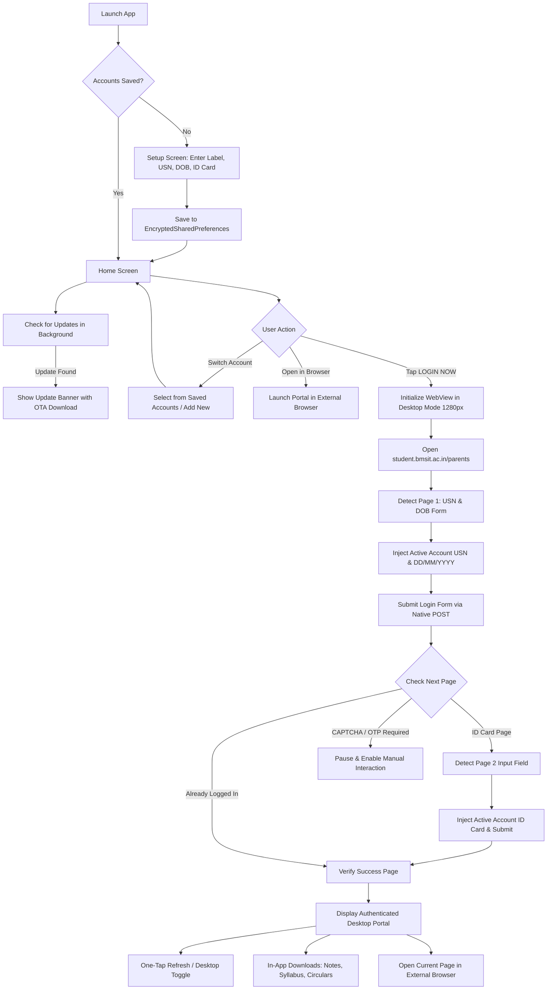

# 🚀 BMSIT CP

<div align="center">

[](https://github.com/adityasing9/BMSIT-CP/actions/workflows/build.yml)
[](https://bmsit-cp.vercel.app)
[](https://github.com/adityasing9/BMSIT-CP/releases/tag/latest)
[-3DDC84?logo=android&logoColor=white)](https://developer.android.com)
[](https://kotlinlang.org)
[](https://developer.android.com/jetpack/compose)
[](https://developer.android.com/reference/androidx/security/crypto/EncryptedSharedPreferences)
[](https://opensource.org/licenses/MIT)

**A high-performance Android utility that automates the repetitive two-step login process for the BMSIT&M ContinueO Portal, delivers an authentic responsive desktop portal experience on mobile, supports multiple student accounts, in-app file downloads, and features automated wireless updates.**

[🌐 **Live Website & Download Hub (bmsit-cp.vercel.app)**](https://bmsit-cp.vercel.app) • [📥 Download Latest APK](#-direct-download) • [✨ Key Features](#-key-features) • [🔄 How It Works](#-how-it-works) • [🔒 Security & Privacy](#-security--privacy-first) • [🏗️ Build from Source](#-building-from-source) • [❓ FAQ](#-frequently-asked-questions-faq)

</div>

---

## 📖 Overview

Every visit to the **BMSIT&M ContinueO Parent Portal** (`https://student.bmsit.ac.in/parents/index.php`) normally requires:
1. Entering your **USN**.
2. Selecting your **Date of Birth** through three separate dropdown menus (Day, Month, Year).
3. Submitting and waiting for server response.
4. Entering your **ID Card Number** on a separate verification screen.
5. Submitting again to finally reach your dashboard.

Furthermore, mobile browsers often render the portal in a cramped, single-column responsive layout where navigation headers and tables are cut off or misaligned.

**BMSIT CP** eliminates this friction:
- **One tap** on **LOGIN NOW** completes the entire 2-step authentication flow in seconds.
- **Multiple Accounts:** Store multiple student profiles (for siblings, friends, or parents managing multiple wards) and switch between them with one tap.
- **Full In-App File Downloads:** Download subject notes (`[NOTES]`), circulars, and syllabus PDFs directly through Android's native `DownloadManager` with session cookies preserved.
- **Open in External Browser:** One-tap option to launch the portal in your preferred browser (Chrome, Brave, Firefox) directly from the Home Screen or from the top navigation bar.
- **Over-The-Air (OTA) Updates:** Seamlessly checks for new builds via Fastly CDN & GitHub Releases with zero rate-limit issues, and installs updates wirelessly.
- **Full Desktop Layout:** Renders the portal in its authentic desktop view by default (1280px viewport), with full pinch-to-zoom and smooth panning.
- **One-Tap Refresh:** Dedicated reload button in the top bar to update attendance, marks, and notices without losing your login session.
- **Permanent Release Keystore:** Signed with a unified, permanent keystore to guarantee conflict-free Over-The-Air updates.
- **100% Local Security:** All credentials stay encrypted on your device with hardware-backed **AES-256-GCM**.

---

## 📥 Direct Download

Ready to use? Grab the latest pre-compiled APK directly from GitHub Releases:

| Release Asset | Description | Direct Link |
| :--- | :--- | :--- |
| **`BMSIT-CP.apk`** | Latest compiled Android APK (`v1.2.15`) | [⬇️ **Download APK**](https://github.com/adityasing9/BMSIT-CP/releases/download/latest/BMSIT-CP.apk) |
| **GitHub Releases** | Release notes, changelog & assets | [📦 **View Releases**](https://github.com/adityasing9/BMSIT-CP/releases/tag/latest) |

> **Note for Installation:** Since this APK is distributed directly outside Google Play Store, Android will ask you to *"Install apps from unknown sources"* or *"Allow installation from this source"*. If Google Play Protect shows a warning (*"Harmful app blocked"*), tap **"Install anyway"** to proceed (see [FAQ #10](#-frequently-asked-questions-faq)).

---

## ⚖️ Why BMSIT CP?

| Feature / Experience | Standard Web Browser | With BMSIT CP |
| :--- | :--- | :--- |
| **Login Time** | 45–60 seconds of repetitive typing | **~2–3 seconds (Single Tap)** |
| **Multiple Accounts** | Log out, retype USN + DOB + ID Card | **Instant 1-tap account switching** |
| **Credential Storage** | Manual typing or clunky browser autofill | **Encrypted local hardware keystore (AES-256)** |
| **Date of Birth Entry** | 3 tedious HTML select dropdowns | **Automated background composition** |
| **Step 2 (ID Card)** | Waiting for page reload + manual typing | **Automated detection & instant entry** |
| **Layout Quality** | Squished mobile layout; clipped tables | **True 1280px Desktop view with zoom** |
| **In-App Downloads** | Often blocked or fails without cookies | **Native DownloadManager with cookies & referers** |
| **External Browser** | Manual URL copy & paste | **1-tap launch in Chrome / Brave / Firefox** |
| **Page Refresh** | Reloads from scratch or loses session | **Dedicated one-tap refresh (keeps session)** |
| **App Updates** | Manual website check & re-download | **Automated Over-The-Air (OTA) update alerts** |
| **Cloud Dependency** | None | **Zero Cloud — 100% On-Device** |

---

## ✨ Key Features

### 👥 1. Multiple Account Support
- **Multi-Profile Management:** Store credentials for multiple students or accounts simultaneously.
- **Custom Account Labels:** Assign friendly names (e.g., "Aditya", "Sister", "Ward 1") to easily distinguish between accounts.
- **Instant Account Switcher:** Switch the active account right from the Home Screen with a single tap before logging in.
- **Account Management in Settings:** Add, edit, switch, or delete accounts individually with confirmation safeguards.
- **Automatic Migration:** Automatically preserves and migrates any existing saved credentials into the multi-account architecture without data loss.

### 🔄 2. In-App Update Alerts & 1-Tap Browser Install
- **Multi-Tier Update Engine:** Checks updates via Fastly CDN (`raw.githubusercontent.com`), HTTP 302 release redirects, and the GitHub REST API. Immune to GitHub API 403 rate limits on mobile networks (Jio, Airtel).
- **Cache-Busting Fallthrough:** Ensures newly pushed releases are detected immediately without waiting for CDN cache expiration.
- **Main Screen Update Popup:** Presents release version and release notes preview directly on the Home Screen.
- **1-Tap Browser Download & Install:** Tapping "Update Now" opens the direct APK download in Chrome/your default browser for clean installation without triggering Play Protect dropper permissions.
- **Permanent Release Keystore:** Signed with a permanent 10,000-day keystore, eliminating signature mismatch conflicts across updates.

### 🌐 3. Open Portal in External Browser
- **Home Screen Access:** A dedicated **"Portal ↗"** button right below the main **"LOGIN NOW 🚀"** button for quick, direct portal access in your default browser.
- **Top App Bar Action:** An **Open in Browser** icon in the Login Screen top bar allows you to open the currently viewed portal page in your device's browser at any time.
- **Post-Login Action:** An **"Open in Browser"** button appears next to "View Dashboard" as soon as authentication completes.
- **Zero Intermediaries:** Directly opens your browser without clipboard copying prompts or annoying redirect dialogs.

### 📥 4. Direct In-App File Downloads ([NOTES], Syllabus & Circulars)
- **Native Android DownloadManager:** Downloads PDF notes, syllabus files, and circulars directly to your device's public `Downloads` directory.
- **Session Cookie Propagation:** Injects active `PHPSESSID` session cookies and `Referer` headers so authenticated downloads succeed without 403 or redirect errors.
- **MIME & Extension Correction:** Automatically resolves proper `.pdf` extensions even when the portal serves files with `.bin` or generic headers.
- **Blob & Data URL Support:** Client-side JavaScript bridge handles dynamic `blob:` and base64 `data:` downloads seamlessly.

### 💾 5. Data Export & Import (Backup & Restore)
- **Portable JSON Backup:** Easily export all your configured accounts to a structured JSON format with a single tap.
- **Direct Clipboard & Share Support:** Copy the backup text directly to your clipboard or use Android's native share sheet to save your backup in Google Drive, Notes, WhatsApp, or Email.
- **Safe Import & Merge:** Restore or transfer accounts to any device with automatic deduplication, ensuring you never lose your saved profiles when changing phones or reinstalling.

### ⚡ 6. Intelligent Two-Step Automation
- **Step 1 (USN & DOB):** Automatically populates `#username`, selects Day (accounting for portal value whitespace), Month, and Year selectors, invokes internal `putdate()` computation, sets the hidden password field, and triggers form validation.
- **Step 2 (ID Card Verification):** Automatically polls the DOM for the verification view, locates the input field, injects the ID card number using native prototype setters, and submits.
- **Native POST Form Preservation:** Web navigation preserves HTTP `POST` requests and form parameters without converting them to blank `GET` requests.
- **Graceful Error Handling:** If the portal issues a CAPTCHA challenge or OTP, automation pauses and gives you a single-tap **Continue Manually** option without interrupting your session.

### 🖥️ 7. Genuine Desktop Mode (Default: ON)
- **Authentic 1280px Viewport:** Bypasses mobile screen-width constraints by reconfiguring the layout viewport to 1280px on page render.
- **Desktop Grid Breakpoints:** Triggers the portal's native UIkit desktop styles, showing the two-column dashboard layout.
- **Smooth Navigation:** Built-in overview mode automatically scales the 1280px canvas to fit your phone screen, supported by full pinch-to-zoom and multi-touch gestures.
- **One-Tap Mode Switcher:** Toggle between `🖥 Desktop ON` and `📱 Mobile` right from the top bar.
- **Persistent Choice:** Your chosen mode is saved locally and remembered whenever you reopen the app.

### 🔄 8. Instant One-Tap Page Refresh
- **Top App Bar Refresh:** Dedicated reload button placed prominently in the top bar.
- **Session Preservation:** Reloads the current page safely using existing authenticated cookies without prompting you to log in again.

### 🚀 9. Speed & Performance Optimizations
- **Hardware-Accelerated WebView:** Enabled `LAYER_TYPE_HARDWARE` for fluid scrolling and 60fps animations.
- **Optimized Delay Pipelines:** Low-latency element detection (150ms intervals) and reactive coroutines.
- **Intelligent Caching:** Configured with `LOAD_DEFAULT` caching and automatic image decoding for immediate page loads.

### 🔒 10. Security & Privacy First
- **Zero Cloud Architecture:** There is **no backend server**, **no telemetry**, **no analytics**, and **no third-party tracking**.
- **AndroidX Security Crypto:** Your USN, Date of Birth, and ID Card Number are encrypted using Google's `EncryptedSharedPreferences` backed by an Android Keystore `MasterKey` (AES-256-GCM / AES-256-SIV).
- **No Log Leaks:** Credential strings are never written to Logcat, included in URLs, or exposed in UI status cards.

### 🎨 11. Theme & Appearance Engine
- **Theme Modes:** Choose between **Follow System**, **Light Theme**, or **Dark Theme**.
- **5 Accent Color Palettes:** Personalize with **Classic Blue**, **Emerald Green**, **Royal Purple**, **Crimson Red**, or **Sunset Amber**.
- **AMOLED Pure Black:** Optional pitch-black dark mode to maximize battery savings on OLED displays.
- **Material You Dynamic Colors:** Seamlessly extract and adapt theme colors from your device wallpaper on Android 12+.
- **Quick Home Screen Toggle:** Tap the theme icon directly on the Home Screen to cycle themes on the fly.

---

## 🔄 How It Works



---

## 📱 System Requirements

| Specification | Requirement |
| :--- | :--- |
| **Operating System** | Android 8.0 Oreo (API level 26) or newer |
| **Target SDK** | Android 14 (API level 34) |
| **Architecture** | `arm64-v8a`, `armeabi-v7a`, `x86`, `x86_64` |
| **Connectivity** | Active Internet connection (Wi-Fi / Mobile Data) |
| **Permissions** | `INTERNET`, `ACCESS_NETWORK_STATE`, `WRITE_EXTERNAL_STORAGE` (max API 28) |

---

## 🛠️ Technology Stack

- **UI & Architecture:** [Jetpack Compose](https://developer.android.com/jetpack/compose) with [Material 3](https://m3.material.io/) design system
- **State & Concurrency:** Kotlin Coroutines, `StateFlow`, and Android Architecture Components (`ViewModel`)
- **Web Automation:** Android `WebView`, custom `WebViewClient`, `WebChromeClient`, and dynamic DOM JavaScript evaluation
- **File Downloads:** Android `DownloadManager` with session cookies, referer headers, and blob JavaScript bridge
- **Storage & Cryptography:** AndroidX Security (`androidx.security:security-crypto:1.1.0-alpha06`) with Android Keystore `MasterKey`
- **Signing:** Dedicated 2048-bit RSA permanent release keystore
- **Build System:** Gradle Kotlin DSL (`build.gradle.kts`)
- **Continuous Integration & OTA Deployment:** GitHub Actions (`.github/workflows/build.yml`)

---

## 🏗️ Building from Source

### Prerequisites
1. **Android Studio** Hedgehog (2023.1.1) or newer
2. **Java Development Kit (JDK):** Version 17
3. **Android SDK Platform:** 34

### Compilation Steps

```bash
# 1. Clone the repository
git clone https://github.com/adityasing9/BMSIT-CP.git
cd BMSIT-CP

# 2. Compile Debug APK using the Gradle Wrapper
./gradlew assembleDebug

# 3. (Optional) Run Unit Tests
./gradlew testDebugUnitTest

# 4. (Optional) Install directly to an attached Android phone or emulator
./gradlew installDebug
```

The output artifact will be generated at:
```
app/build/outputs/apk/debug/app-debug.apk
```

---

## 📂 Codebase Structure

```
app/src/main/java/com/continueo/autologin/
├── ContineoApp.kt                    # Application class
├── MainActivity.kt                   # Single activity entry point & navigation router
│
├── models/
│   ├── Credentials.kt                # Credentials & AccountProfile data models
│   └── AutomationState.kt            # Automation state machine definitions
│
├── security/
│   └── CredentialManager.kt          # Multi-account AES-256 storage & migration manager
│
├── automation/
│   ├── ContineoSelectors.kt          # Portal DOM selectors, URLs, and timing constants
│   ├── ContineoAdapter.kt            # Robust JavaScript generators for form autofill
│   ├── AutomationEngine.kt           # Coroutine-based automation state manager
│   └── WebViewManager.kt             # WebView desktop mode, download pipeline & JS bridge
│
├── ui/
│   ├── theme/                        # Material 3 color palettes, typography, and theme
│   ├── navigation/                   # Compose Navigation graph & destinations
│   ├── screens/
│   │   ├── SetupScreen.kt            # Add / edit credentials and account profiles
│   │   ├── HomeScreen.kt             # Account switcher, update banner & "LOGIN NOW"
│   │   ├── LoginScreen.kt            # WebView display, status timeline, refresh & desktop toggle
│   │   └── SettingsScreen.kt         # Account management, check updates & app details
│   └── viewmodels/
│       └── LoginViewModel.kt         # UI state orchestration & automation bridge
│
└── utils/
    ├── NetworkUtils.kt               # Real-time network connectivity monitor
    └── UpdateManager.kt              # Multi-tier GitHub release checker, OTA downloader & installer
```

---

## ❓ Frequently Asked Questions (FAQ)

<details>
<summary><b>1. How does multiple account login work?</b></summary>
You can save as many accounts as you need (e.g. for multiple siblings or wards). Each account has its own USN, Date of Birth, ID Card Number, and an optional display label. On the Home Screen, simply tap the account card or the "Switch" button to pick which account you want to use. Tapping "LOGIN NOW" will immediately log in with the selected account.
</details>

<details>
<summary><b>2. How does the in-app update check work?</b></summary>
On startup or via "Check for Updates" in Settings, BMSIT CP checks for new releases. If an update is found, an update popup appears with release highlights. Tapping "Update Now" launches the direct APK download in your browser so Chrome/your system installer updates the app seamlessly without extra dropper permissions.
</details>

<details>
<summary><b>3. Are my college credentials safe?</b></summary>
Yes, 100%. Your credentials never leave your physical device. They are encrypted using the Android Keystore system with AES-256-GCM encryption. The app has no backend servers, no analytics SDKs, and no tracking code.
</details>

<details>
<summary><b>4. Can I download subject notes and circulars inside the app?</b></summary>
Yes! Tapping <b>[NOTES]</b> or any PDF/circular download link downloads the file directly to your phone's <b>Downloads</b> folder using Android's native <code>DownloadManager</code>. Session cookies and referer headers are forwarded automatically so authenticated files download without permission errors.
</details>

<details>
<summary><b>5. How do I open the portal in an external browser (Chrome / Brave)?</b></summary>
There are three convenient ways:
1. <b>Home Screen:</b> Tap <b>"Portal ↗"</b> directly below the "LOGIN NOW" button.
2. <b>Login Screen Top Bar:</b> Tap the <b>Open in Browser</b> icon anytime while viewing the portal.
3. <b>Login Complete:</b> Tap <b>"Open in Browser"</b> on the completion card once authenticated.
</details>

<details>
<summary><b>6. What happens if the portal displays a CAPTCHA or OTP?</b></summary>
The app is built to adhere strictly to security best practices. If an anti-bot check or OTP appears, the automated sequence pauses immediately, flags the step, and offers a <b>Continue Manually</b> button so you can solve it yourself in the WebView.
</details>

<details>
<summary><b>7. How do I refresh the portal to check for new marks or attendance?</b></summary>
Simply tap the <b>Refresh</b> icon located in the top app bar anytime. The portal page reloads immediately while keeping your authenticated session active.
</details>

<details>
<summary><b>8. How do I switch between Desktop and Mobile layout?</b></summary>
At the top right of the login screen, tap the <b>🖥 Desktop ON / 📱 Mobile</b> button. The app will immediately adjust the user-agent and viewport and reload the page while preserving your authenticated session.
</details>

<details>
<summary><b>9. How do I backup or transfer my accounts to another phone?</b></summary>
Go to <b>Settings → Data Management</b>:
- Tap <b>Export Accounts Backup</b> to copy or share your JSON backup.
- On your new device, tap <b>Import Accounts Backup</b>, paste the text, and tap <b>Import</b>. Your accounts will be restored immediately without re-typing.
</details>

<details>
<summary><b>10. Why does Google Play Protect show "Harmful app blocked"?</b></summary>
Because BMSIT CP is an open-source, sideloaded app that is self-signed and not hosted on the Google Play Store, Google Play Protect displays a generic warning for unrecognized application signatures. 

To proceed with installation, simply tap <b>"Install anyway"</b> (located right above the blue "Got it" button).
</details>

<details>
<summary><b>11. Why does Android show "App not installed as package conflicts with an existing package"?</b></summary>
Android requires every app update to be signed with the <b>exact same cryptographic key</b> as the installed app. Earlier automated CI builds used temporary runner keys that changed with every build. Starting from <b>v1.2.0</b>, a permanent release keystore is embedded in the repository so all updates share the exact same signature.

If updating from a pre-v1.2.0 version:
1. Open <b>Settings → Data Management → Export Accounts Backup</b> and tap <b>Copy to Clipboard</b> (or Share).
2. Uninstall the old conflicting app from your device (one-time requirement).
3. Install the latest APK from GitHub Releases.
4. Open <b>Settings → Import Accounts Backup</b>, paste your data, and tap <b>Import</b>.
All future updates will now install seamlessly over the air with zero signature conflicts.
</details>

---

## ⭐ Say Thank You & Show Support

If you want to say thank you or you are happy with **BMSIT CP**, please consider:
- **Giving this repository a ⭐ star!** It helps more BMSIT students and parents discover the utility.
- **[Following @adityasing9 on GitHub](https://github.com/adityasing9)** for more interesting tools, utilities, and open-source projects!
- **Sharing BMSIT CP** with your classmates, batchmates, and friends via WhatsApp!
- **Sending Feedback or Reporting Issues** right inside the app (**Settings → Send Feedback**) or at [**bmsit-cp.vercel.app/feedback**](https://bmsit-cp.vercel.app/feedback)!

---

## 📄 License

This project is licensed under the [MIT License](LICENSE).

**Disclaimer:** This software is an independent, client-side productivity tool designed exclusively for authorized students and parents accessing their own BMSIT&M ContinueO portal accounts. It does not tamper with or bypass college security protocols. The developers assume no responsibility for any unauthorized usage.
